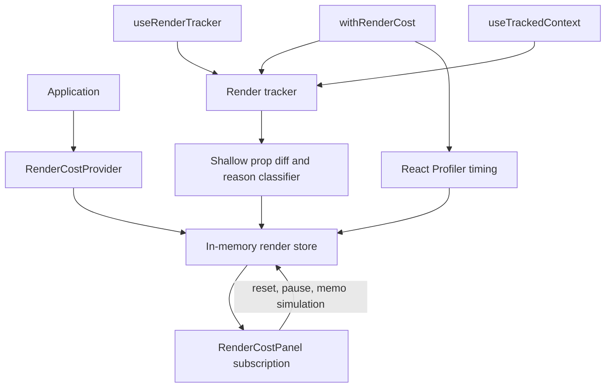

# RenderCost

RenderCost is a small React developer tool for spotting unnecessary component
renders, seeing which props changed, and trying a memoization fix without
editing application source.


<!-- Replace the GIF placeholder above with a short recording of the demo app. -->

## Run the demo

```sh
npm install
npm run dev
```

Click **Increment counter** to trigger the four intentional render cases. Open
the RenderCost panel in the lower-right corner, select a component to inspect
its reasons and recent events, and try **Simulate memo**.

## Use in an application

Wrap the application in `RenderCostProvider`, then instrument individual
components with the HOC or hook. Mount `RenderCostPanel` during development.

```tsx
import {
  RenderCostPanel,
  RenderCostProvider,
  useRenderTracker,
  withRenderCost,
} from "./rendercost";

const TrackedButton = withRenderCost(
  ({ onClick }: { onClick: () => void }) => (
    <button onClick={onClick}>Save</button>
  ),
  "SaveButton",
);

function TrackedList({ items }: { items: string[] }) {
  useRenderTracker("TrackedList", { items });
  return <ul>{items.map((item) => <li key={item}>{item}</li>)}</ul>;
}

export function App() {
  return (
    <RenderCostProvider>
      <TrackedButton onClick={() => console.log("saved")} />
      <TrackedList items={["one", "two"]} />
      <RenderCostPanel />
    </RenderCostProvider>
  );
}
```

For context consumers, use `useTrackedContext` so context-driven renders are
identified separately:

```tsx
const ThemeContext = createContext({ mode: "light" });
ThemeContext.displayName = "Theme";

function ThemedView() {
  const theme = useTrackedContext(ThemeContext);
  return <div data-mode={theme.mode}>Themed content</div>;
}
```

## What it reports

- **Value changed**: a primitive changed, or a new object reference has
  different content.
- **New function reference**: function identity changed while its source stayed
  the same.
- **New object/array reference**: the reference changed but its content is
  deeply equal.
- **Context update**: a value read through `useTrackedContext` changed.
- **Parent re-render**: tracked props stayed shallowly identical.

The panel sorts by unnecessary render count, shows aggregate counts and wasted
time, and lists the latest 10 render events for the selected component.
Suggestions include `useCallback`, `useMemo`, or `React.memo`, depending on the
recorded reason. **Copy snippet** copies the suggested after-code. **Simulate
memo** memoizes the tracked boundary at runtime; it does not edit source files.

The HOC returns the original component in production. Disable tracking with
`store.setEnabled(false)` via `useRenderCostStore`, or use the panel's Pause
button. Render data is kept in an in-memory store and can be cleared with Reset.

## System architecture

The source is divided into the library (`src/rendercost`) and the demo
application (`src/demo`).



`RenderCostProvider` creates one store per provider tree. The store holds
component aggregates and a bounded render-event history, publishes immutable
snapshots to subscribers, and does not use React state for each log write.
`withRenderCost` instruments a component and measures its committed render with
React Profiler. The hook APIs track function and context changes; the panel
subscribes to the store to display the latest snapshot. Simulated memo mode
memoizes the tracked boundary in memory and never rewrites application files.
The production HOC returns the wrapped component directly.

## Runtime workflow

1. Mount `RenderCostProvider` around the application and opt components into
   tracking with `withRenderCost` or `useRenderTracker`.
2. On each tracked render, compare the current props/context with the previous
   snapshot and classify changed values, recreated references, context updates,
   or unchanged props.
3. Store the event and update aggregate counts. The HOC records committed
   duration through Profiler; the hook records elapsed time through its layout
   effect.
4. `RenderCostPanel` sorts components by unnecessary-render count. Select a row
   to inspect its reason counts and recent render events.
5. Apply a suggested fix in your source, or use **Simulate memo** to preview
   whether memoization prevents unchanged-prop renders. Reset clears recorded
   history; Pause stops collecting new events.

The project workflow is to run the demo locally, run the focused Vitest suite,
and verify the production bundle:

```sh
npm install
npm run dev
npm test
npm run build
```

## License

This project is distributed under the [MIT License](./LICENSE).

## Development

```sh
npm test
npm run build
```
